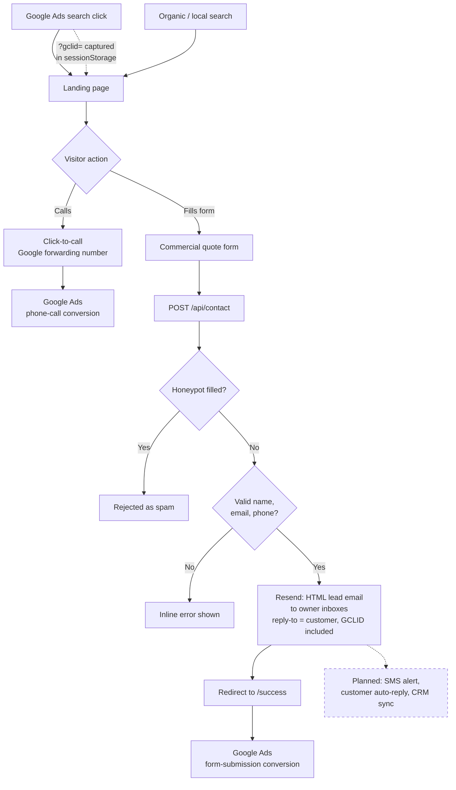
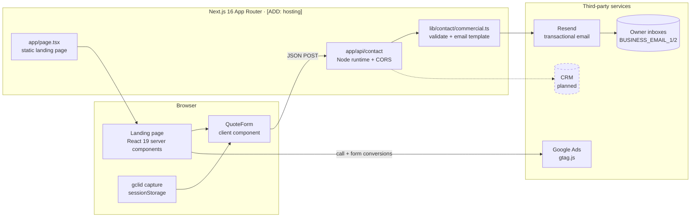

<div align="center">

# 🎄 Denver Christmas Lights: Commercial

**A conversion-focused lead generation site that turns Google Ads clicks from Denver property managers into qualified quote requests and phone calls.**

[**Live site →**]([ADD: live URL])


</div>

---

## 📑 Table of Contents

- [The Problem → The Solution](#-the-problem--the-solution)
- [Results at a Glance](#-results-at-a-glance)
- [Key Features](#-key-features)
- [Lead Flow](#-lead-flow)
- [System Architecture](#-system-architecture)
- [Tech Stack](#-tech-stack)
- [Email & Lead Infrastructure](#-email--lead-infrastructure)
- [Tracking & Attribution](#-tracking--attribution)
- [SEO & Performance](#-seo--performance)
- [Project Structure](#-project-structure)
- [Getting Started](#-getting-started)
- [Roadmap](#-roadmap)
- [About the Developer](#-about-the-developer)

---

## 💡 The Problem → The Solution

Commercial holiday lighting is a high-ticket, short-season purchase. A property manager, HOA board or retail center decides on a vendor within a few weeks, often straight from a Google search. A brochure site that looks nice but doesn't capture the lead, or can't prove which ad produced it, wastes ad spend during the only months that matter.

This site is built around one action: **get a qualified commercial prospect to request a quote or call.** Every section points to a short quote form or a click-to-call button. Every submission is validated, emailed to the owner immediately with the customer set as reply-to, and tied back to the Google Ads click that produced it, so ad spend can be measured against real leads.

---

## 📊 Results at a Glance

| Metric | Value |
|---|---|
| Lighthouse Performance (mobile) | `95` |
| Lighthouse Accessibility / Best Practices / SEO | `98 / 100 / 100` |
| Largest Contentful Paint (mobile) | `1.2s` |
| Landing page conversion rate | `[ADD: conversion rate]` |
| Cost per lead | `[ADD: cost per lead]` |
| Leads per season | `[ADD: lead volume]` |
| Phone calls tracked from ads | `[ADD: call volume]` |

---

## ✨ Key Features

### Lead Generation
- **Two quote forms on one page** (hero and closing section), so there's always a form near the visitor without a long scroll back up.
- **Commercial-specific fields**: business name, property address and multi-select services, so the owner can price the job before the first call.
- **Click-to-call everywhere**: header, mobile menu, hero and thank-you page, for buyers who would rather talk than type.

### Conversion Optimization
- **Single-goal landing page**: every in-page CTA links to `#quote`; there's no navigation that pulls visitors away.
- **Trust built in sequence**: reviews, before/after project photos, process steps, property types served and FAQs answer objections before they're raised.
- **Clear post-submit experience**: a dedicated `/success` page confirms the request and offers a direct call option.
- **Spam protection with no added friction**: a hidden honeypot field rejects bots, with no CAPTCHA to put off real buyers.

### SEO
- **Commercial-intent metadata**: the title and description target "commercial Christmas light installation Denver".
- **Service-area coverage**: Denver, Aurora, Lakewood, Centennial, Littleton, Arvada, Westminster, Highlands Ranch, Parker and Englewood are listed on the page.
- **Utility pages kept out of the index**: `/success` is `noindex, nofollow`, so thank-you pages don't show up in search.

### Performance
- **Modern image pipeline**: `next/image` serves AVIF/WebP at responsive sizes.
- **Long-lived caching**: static assets ship with a one-year immutable `Cache-Control` header.
- **Analytics stays off the critical path**: gtag loads `afterInteractive`, with a preconnect to Google Tag Manager.
- **Self-hosted fonts** via `next/font` (Montserrat and Open Sans) with `display: swap`.

### Admin / Content
- **All copy in one file**: services, reviews, FAQs, service areas, stats and the phone number live in `components/commercial/content.ts`, so content updates don't touch layout code.
- **Configurable lead recipients**: up to two notification inboxes, set by environment variable without redeploying code.

---

## 🔀 Lead Flow

What happens from the first ad click to a measured conversion:



---

## 🏗️ System Architecture



---

## 🧰 Tech Stack

| Layer | Technology | Why I chose it |
|---|---|---|
| Framework | **Next.js 16** (App Router) | Server-rendered pages for fast first paint and SEO, plus API routes in the same codebase |
| UI | **React 19** | Server components keep the landing page mostly static; only the form ships interactive JS |
| Language | **TypeScript 5** | Typed lead payloads between the form, API and email template |
| Styling | **Scoped CSS** (`.dcl`) + **Tailwind CSS 4** | Hand-tuned CSS for the landing page; Tailwind for the secondary pages |
| Motion | **motion**, **swiper** | Light animation and carousels for reviews and project galleries |
| Icons | **lucide-react**, **react-icons** | Tree-shakeable SVG icons |
| Email | **Resend** | Simple API, verified sending domain, good deliverability |
| Tracking | **Google Ads gtag.js** | Native form and phone-call conversions that feed bidding directly |
| Images | **next/image** (AVIF/WebP) | Smaller payloads on mobile, where most ad traffic comes from |
| Hosting | `[ADD: hosting provider]` | `[ADD: reason]` |

---

## 📬 Email & Lead Infrastructure

**Business outcome:** every valid quote request reaches the owner's inbox within seconds, formatted so they can reply or call with one tap, and a failed delivery is visible instead of silent.

- **Instant owner notifications**: each lead is sent through Resend as a branded HTML email with the name, business, phone (a `tel:` link), email, address, selected services, message and GCLID.
- **One-click reply**: `replyTo` is set to the customer, so hitting "Reply" goes straight to the prospect.
- **Multiple recipients**: `BUSINESS_EMAIL_1` and `BUSINESS_EMAIL_2` both receive leads. Blank values are skipped, duplicates are removed, and the legacy `BUSINESS_EMAIL` is still honored.
- **Deliverability**: mail is sent from a Resend-verified domain. `[ADD: confirm SPF / DKIM / DMARC records for the sending domain]`
- **No silent failures**: if Resend rejects a send, the API returns an error (HTTP 502) and the visitor stays on the form with a message, instead of being sent to a thank-you page for a lead that never arrived. Each step of the request is logged server-side.
- **Input hardening**: fields are trimmed and length-capped, email and phone are validated, all values are HTML-escaped in the email template, and a honeypot blocks bots.

<details>
<summary><strong>API contract: <code>POST /api/contact</code></strong></summary>

```jsonc
{
  "formType": "commercial",        // routes to the commercial handler
  "firstName": "Jane",
  "lastName": "Doe",
  "name": "Jane Doe",
  "email": "jane@example.com",
  "phone": "(303) 555-0100",
  "business": "Example Plaza",
  "address": "123 Main St, Denver, CO",
  "services": ["Rooflines", "Trees & Shrubs"],
  "message": "Two buildings, ~400 ft of roofline.",
  "gclid": "Cj0KCQ...",            // empty when not from an ad
  "honeypot": ""                   // must stay empty
}
```

| Response | Meaning |
|---|---|
| `200 { success: true }` | Lead accepted (and emailed when recipients are configured) |
| `400` | Validation failed or honeypot tripped |
| `502` | Email provider rejected the send |
| `500` | Unexpected server error |

Payloads without `formType: "commercial"` fall through to a legacy residential handler that accepts field aliases (`fullName`, `zipCode`, `property_type`, `comments`). The route also answers `OPTIONS` for cross-origin form posts.

</details>

---

## 🎯 Tracking & Attribution

**Business outcome:** Google Ads learns which keywords produce real leads and calls, not just clicks, and each emailed lead carries the click ID that produced it.

- **GCLID capture**: `lib/gclid.ts` reads `?gclid=` from the landing URL, sanitizes it and stores it in `sessionStorage`, so it survives reloads and in-tab navigation. The server sanitizes it again before it goes into the lead email.
- **Form conversions**: the conversion event fires from `app/success/layout.tsx`, and `/success` is only reached after the API confirms the lead was accepted, so the count only includes real leads.
- **Phone-call conversions**: gtag's `phone_conversion_number` config lets Google Ads swap in a forwarding number and record calls from ad visitors. `lib/gtag.ts` also exposes `reportPhoneConversion()` for click-to-call events.
- **Closing the loop**: since every lead email includes its GCLID, closed deals can be uploaded back to Google Ads as offline conversions. `[ADD: whether offline conversion import is in use]`

---

## 🚀 SEO & Performance

**Business outcome:** fast pages lower cost-per-click through better Quality Scores and keep mobile visitors from leaving before the form loads.

- **Metadata** aimed at commercial search intent, plus app-icon and web-manifest conventions (`app/manifest.ts`).
- **Service-area section** covering ten Denver-metro cities.
- **Indexing hygiene**: thank-you and privacy pages set robots directives.
- **Images**: AVIF/WebP, responsive `deviceSizes`, a whitelist of quality levels, and one-year immutable caching.
- **Lean runtime**: server components by default, deferred third-party scripts, `poweredByHeader` disabled, compression on.


---

## 🗂️ Project Structure

<details>
<summary><strong>Annotated folder tree</strong></summary>

```text
.
├── app/
│   ├── page.tsx                 # Commercial landing page (server component, all sections)
│   ├── landing.css              # Landing styles, scoped under .dcl
│   ├── layout.tsx               # Root layout, metadata, gtag + phone-call conversion
│   ├── manifest.ts              # Web app manifest
│   ├── api/contact/route.ts     # Lead endpoint: honeypot, routing, Resend, CORS
│   ├── success/
│   │   ├── layout.tsx           # Fires the form-submission conversion
│   │   └── page.tsx             # Thank-you page (noindex)
│   ├── privacy-policy/          # Privacy policy (uses legacy components)
│   └── backup/                  # Archived earlier page, not routed from home
├── components/
│   ├── commercial/
│   │   ├── content.ts           # ← All copy & data: services, reviews, FAQs, areas, phone
│   │   ├── QuoteForm.tsx        # Lead form (hero + alternate variants)
│   │   ├── SiteHeader.tsx       # Sticky header with click-to-call
│   │   ├── BeforeAfter.tsx      # Project before/after comparisons
│   │   ├── Snowfall.tsx         # Seasonal decorative effects
│   │   ├── StringLights.tsx
│   │   ├── fonts.ts             # Montserrat + Open Sans via next/font
│   │   └── Icons.tsx, BrandLogo.tsx
│   └── *.tsx                    # Legacy residential components (privacy page only)
├── lib/
│   ├── api.ts                   # CONTACT_API_URL (supports a separate backend origin)
│   ├── gclid.ts                 # GCLID capture + sanitization
│   ├── gtag.ts                  # Phone-call conversion helper
│   └── contact/
│       ├── commercial.ts        # Lead parsing, validation, subject, HTML email
│       └── recipients.ts        # Business inbox resolution from env
├── public/                      # Images grouped by page section
└── next.config.ts               # Image formats, cache headers, remote patterns
```

</details>

---

## 🛠️ Getting Started

### Prerequisites
- **Node.js** 20+ (or **Bun**)
- A **Resend** account with a verified sending domain

### Install
```bash
git clone https://github.com/ahmed0234/Denver-Christmas-Lights-Landing-Page-Commercial.git
cd Denver-Christmas-Lights-Landing-Page-Commercial
npm install        # or: bun install
```

### Environment variables
Create `.env.local` in the project root:

| Variable | Required | Description |
|---|---|---|
| `RESEND_API_KEY` | Yes | API key used to send lead notification emails |
| `BUSINESS_EMAIL_1` | Recommended | Primary inbox that receives leads (`BUSINESS_EMAIL` is accepted as a fallback) |
| `BUSINESS_EMAIL_2` | No | Secondary inbox that receives leads |
| `NEXT_PUBLIC_API_URI` | No | Origin of the API if it's hosted separately; defaults to same origin. Inlined at build time |
| `RESEND_INSECURE_TLS` | No | `true` disables TLS verification. **Local development only** |

> If no business email is set, leads are still accepted but not emailed, and the server logs a warning.

### Run locally
```bash
npm run dev        # http://localhost:3000
```

### Quality checks
```bash
npm run lint
npx tsc --noEmit   # type-check (the build skips type errors on purpose)
```

### Build & deploy
```bash
npm run build
npm run start
```
Deploy to `[ADD: hosting provider]` and set the environment variables above in its dashboard. If the business phone number changes, update `components/commercial/content.ts` **and** the `phone_conversion_number` in `app/layout.tsx`.

---

## 🗺️ Roadmap

- [ ] **Customer auto-reply email** confirming receipt and setting response-time expectations
- [ ] **SMS lead alerts** to the owner (e.g. Twilio) for faster first contact
- [ ] **CRM sync** (HubSpot / GoHighLevel) with GCLID and UTM fields stored per lead
- [ ] **Structured data**: `LocalBusiness`, `Service` and `FAQPage` JSON-LD for richer search results
- [ ] **`sitemap.xml` + `robots.txt`** and dedicated service-area pages for key suburbs
- [ ] **UTM capture + offline conversion import** to report revenue, not just leads, back to Google Ads

---

## 👋 About the Developer

I build websites that bring in business for service companies: fast landing pages, lead capture that doesn't lose submissions, and tracking that connects ad spend to actual leads.

**Need a site that brings in leads, not just compliments?** Let's talk.

**Ahmed Hassan** · 📧 [ahmedkiller0234@gmail.com](mailto:ahmedkiller0234@gmail.com) · 🌐 [ahmedhportfolio.vercel.app](https://ahmedhportfolio.vercel.app/)

---

<div align="center">
<sub>© 2026 Ahmed Hassan. All rights reserved. Built for Denver Christmas Lights.</sub>
</div>
